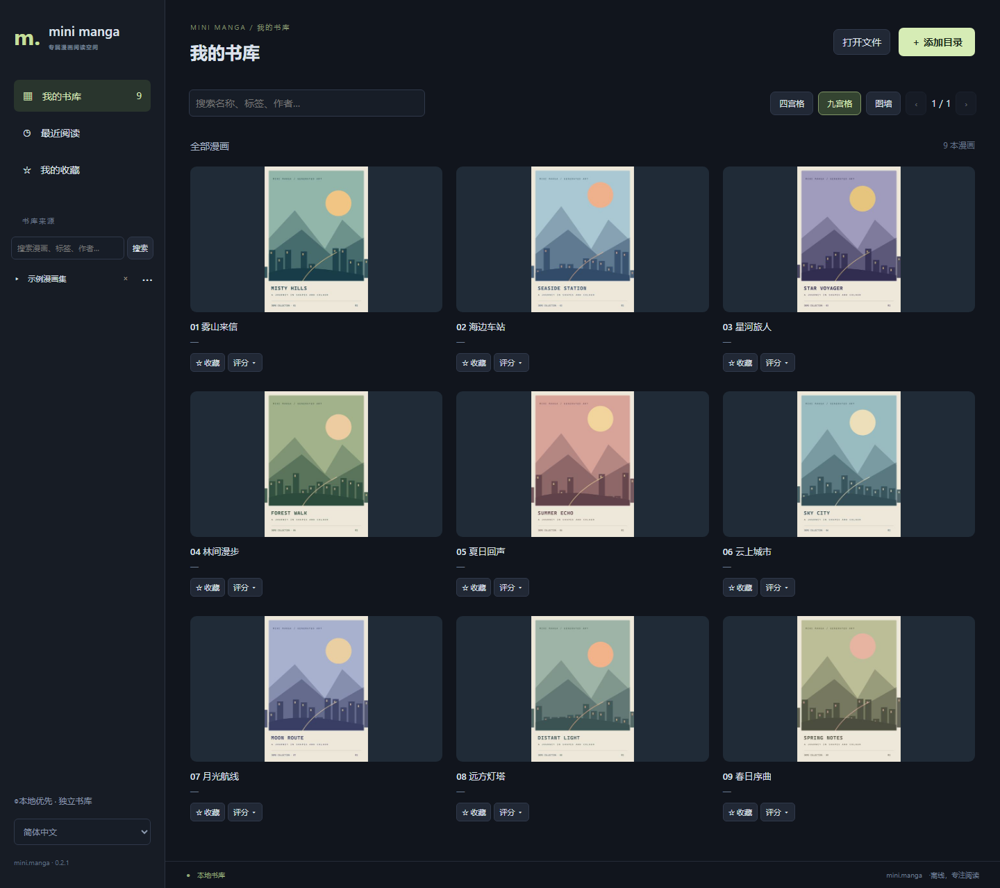
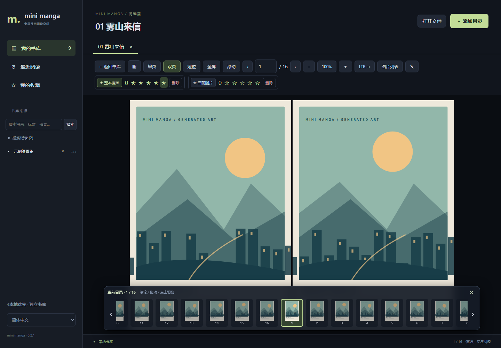
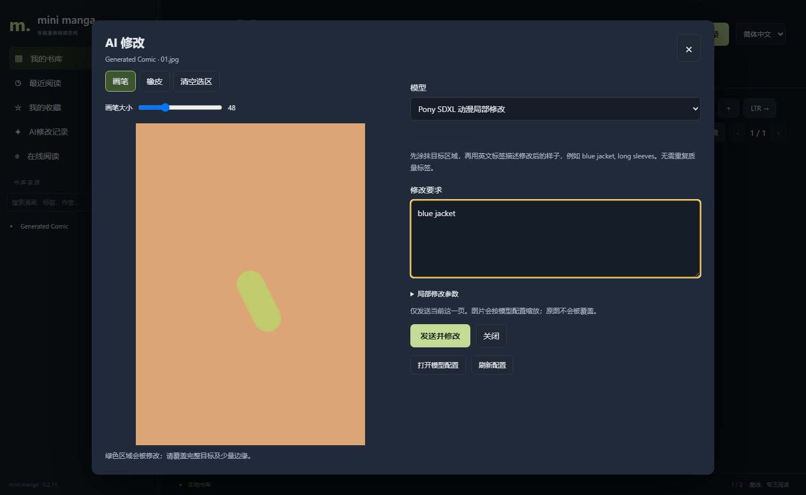

<div align="center">
  
  <h1>Mini Manga</h1>
  <p><a href="README.md">简体中文</a> · <strong>English</strong></p>
  <p>A manga library and reader for Windows x64</p>
</div>



Mini Manga organizes comics stored in folders, archives, and PDFs. Browse covers, search by title, tags, or author, and read in single-page, double-page, or continuous mode. Your library, favorites, ratings, and reading progress are stored on your computer. The screenshots use generated sample pages.

## Getting started

1. Download the Windows x64 ZIP from [GitHub Releases](https://github.com/yekq/MiniMangaBrowser/releases).
2. Extract the entire archive and run **Mini Manga.exe**.
3. Use **Add folder** or **Open file** to import comics. The language selector in the top-right corner changes the app interface to English.

## Library and reader

| Feature | What you can do |
| --- | --- |
| Browse and organize | Expand folders as needed, browse cover grids, resize the sidebar, and locate a comic in the source tree or File Explorer. |
| Read | Use single-page, double-page, or continuous scrolling mode. Zoom, jump to a page, switch reading direction, or enter fullscreen. |
| Navigate | Use the looping thumbnail strip to jump between pages. At the end of a comic, browse nearby comics from the same folder. |
| Save your place | Resume reading, keep several books open in tabs, and favorite or rate books, folders, and individual pages. |
| Find moved files | Use Everything to search for a comic whose folder or archive has moved. Review the candidates and confirm the new path. |
| Manage local files | Move supported files to the Recycle Bin after confirmation, or remove an imported source from the library index. |



The reader supports image folders, individual images such as JPEG, PNG, and WebP, PDF, and common archive formats including ZIP/CBZ, RAR/CBR, and 7z. Windows shortcuts to supported files and folders can also be imported.

## Online reading and search

The online library supports E-Hentai and nHentai. Browse covers, search titles, or open a gallery URL. You can save additional websites and read public image links or static pages that contain images.

Right-click a comic title, or select part of it and right-click, to search the local library, view online results in Mini Manga, or open the search in your browser. Custom search schemes use a URL template with a `{query}` placeholder.

Use **Cache for offline reading** to save a complete comic to the local library. If a site returns HTTP 429, the download waits and retries. Longer delays or repeated rate limits can save completed pages for a later retry.

## AI image editing

The reader can send the current page to a configured image editing service. You can paint a mask, compare the result with the original, and save the result as a separate PNG. The app includes ComfyUI workflow presets for Pony SDXL and FLUX.2 klein. See the [AI setup guide in Chinese](docs/AI-EDIT.md) for model and service requirements.



## Development

Use Windows x64 and Node.js 24 or later.

```powershell
npm ci
npm run dev
```

| Command | Purpose |
| --- | --- |
| `npm run typecheck` | Run TypeScript checks |
| `npm run build` | Build the main process, preload, workers, and renderer |
| `npm test` | Build and run the unit and Electron integration tests |
| `npm run package` | Build and package the Windows application |

The Electron backend is in `src/main`, the React interface is in `src/renderer`, and the shared contracts are in `src/contracts`. See the [validation notes in Chinese](VALIDATION.md) for test coverage and known limitations.

## License

Mini Manga's original code and documentation use the [MIT License](LICENSE). Bundled dependencies, including 7-Zip and the Everything SDK, are covered by their [respective licenses](resources/THIRD_PARTY.md).
