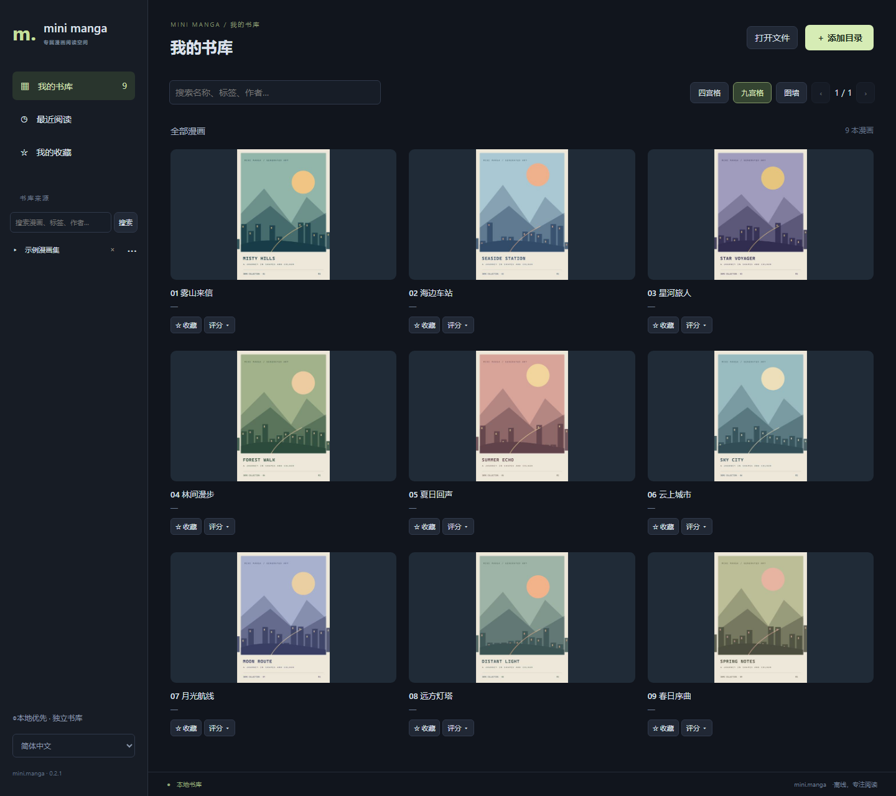
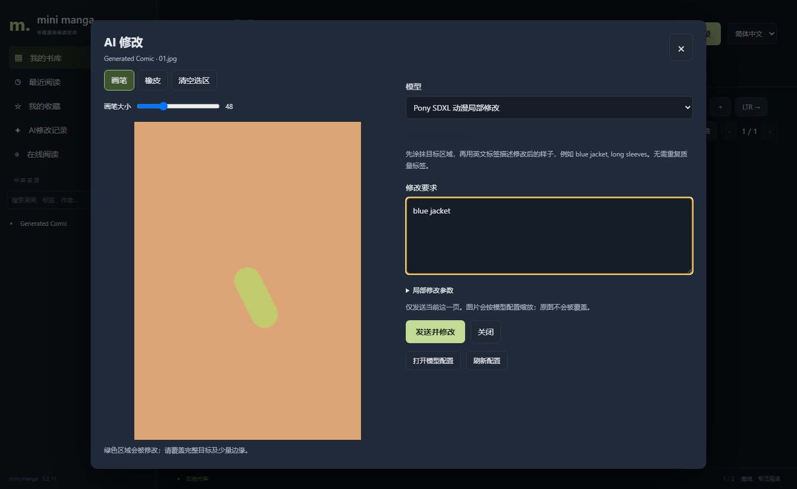
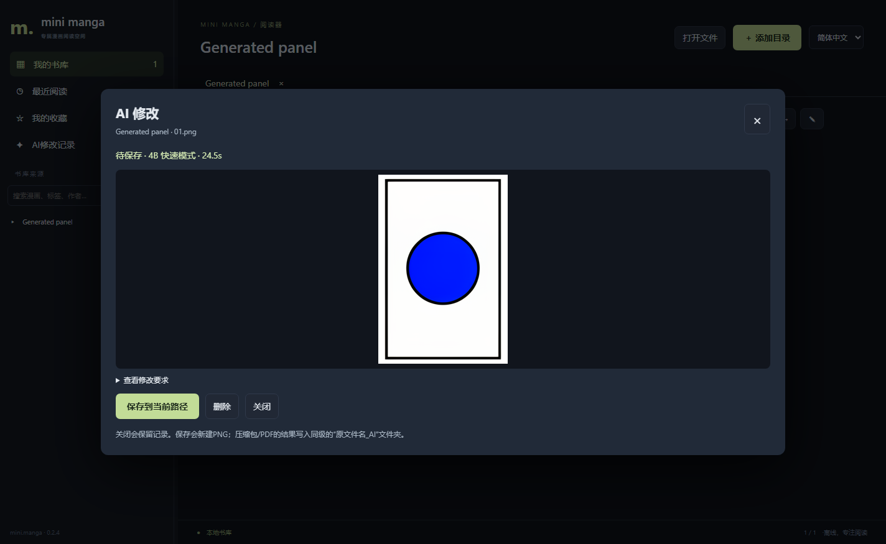
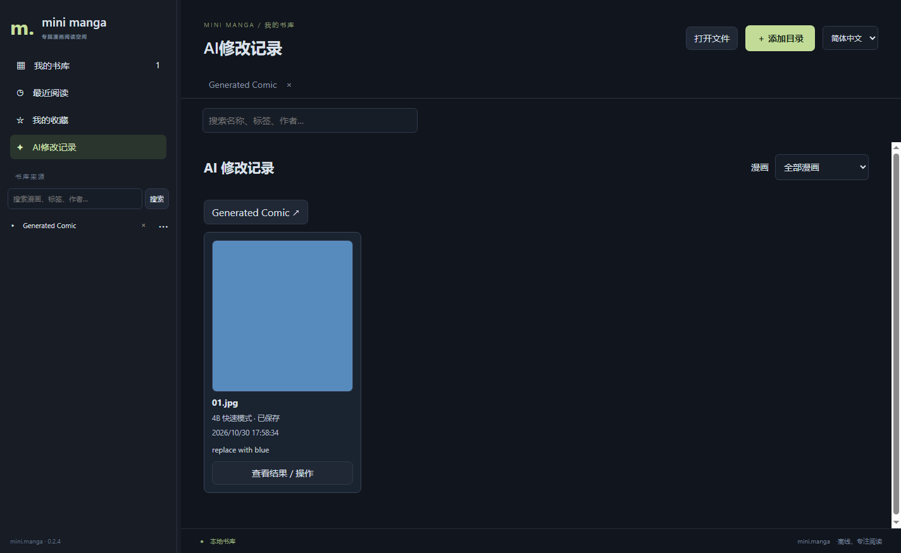
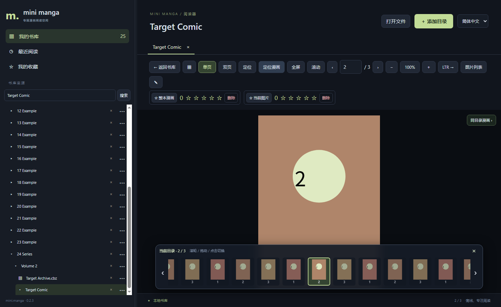
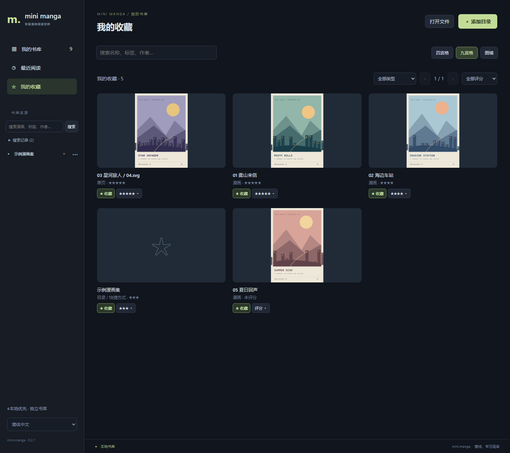
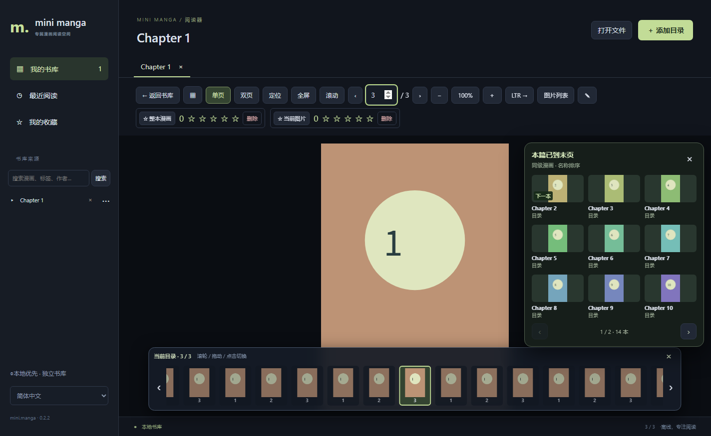
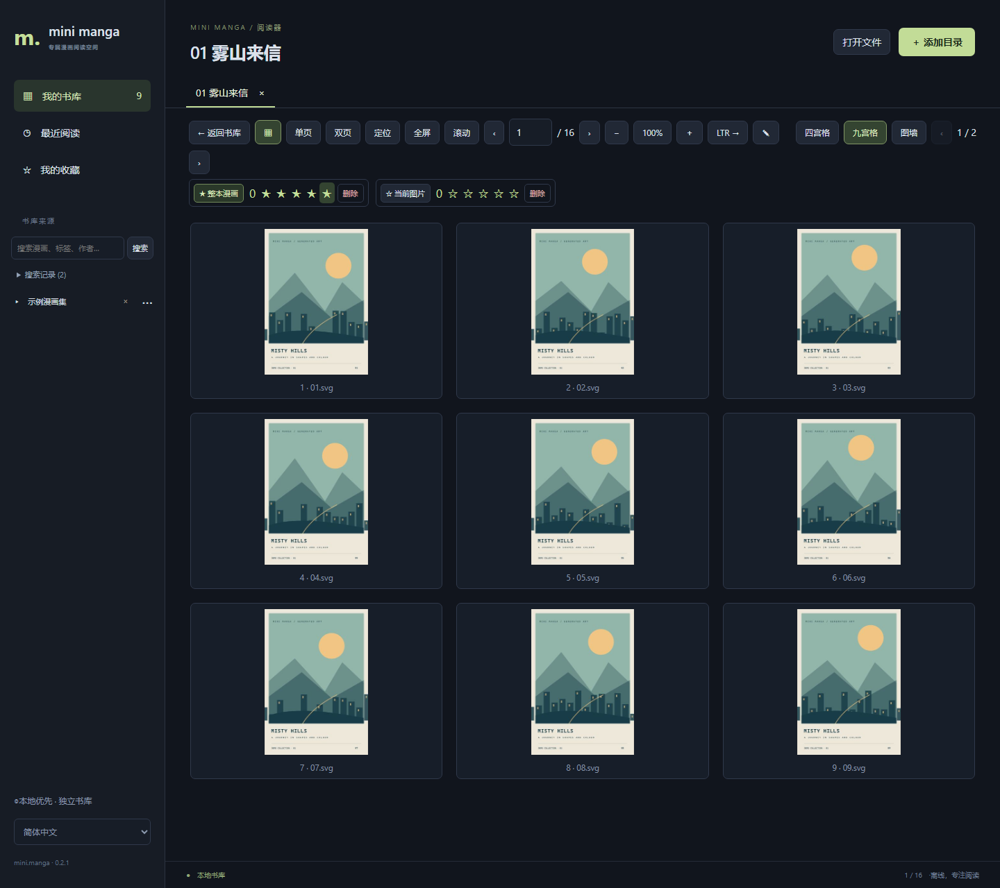
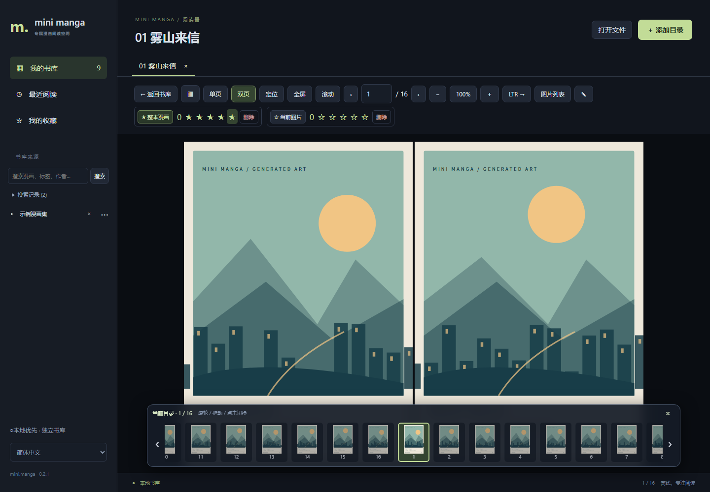
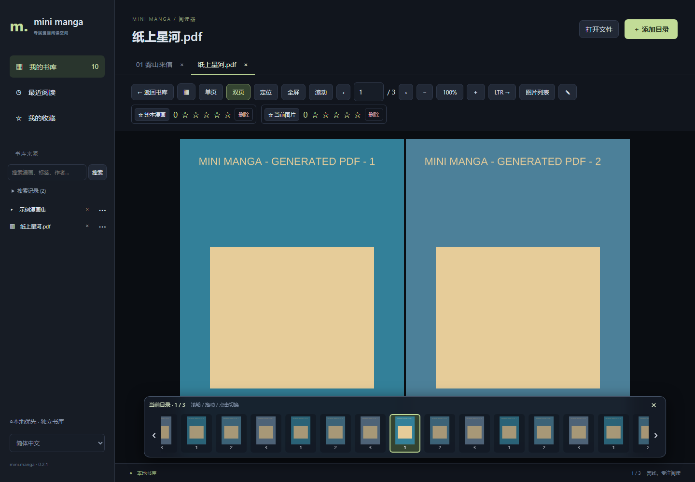

<div align="center">
  
  <h1>Mini Manga</h1>
  <p><strong>简体中文</strong> · <a href="README.en.md">English</a></p>
  <p>把漫画留在本地，把注意力交给故事。</p>
  <p>Windows 本地漫画书库与阅读器 · 中文默认 · 压缩漫画直读</p>
  <p><code>mini.manga</code> · v0.2.11 · Electron + React + TypeScript</p>
</div>



Mini Manga 将散落在文件夹、压缩包和 PDF 中的漫画组织成一个本地书库。添加目录后，按封面浏览、搜索名称或标签，打开漫画即可切换单页、双页与连续滚动阅读。也可以收藏整本漫画、目录、快捷方式或某一页，用星级整理喜欢的内容。书库、收藏和阅读进度保存在本机，无需注册账号。

> 当前为早期可运行版本，面向 Windows x64。截图来自真实应用，内容为脚本生成的示例图形，不包含个人漫画、文件路径或第三方漫画作品。

## 主要功能

| 场景 | 已实现功能 |
| --- | --- |
| AI修改 | 当前页发送到可配置的图片编辑服务，预览、另存PNG、回收站删除；按漫画记录历史，默认Pony SDXL + Inpaint + ControlNet + IPAdapter，支持画笔遮罩及4B/9B切换 |
| 整理书库 | 添加目录、打开漫画文件、左侧目录按需展开、识别指向文件夹或压缩包的 Windows 快捷方式 |
| 查找内容 | 按名称、标签和作者搜索；编辑标签与作者；查看最近阅读 |
| 找回漫画 | 点击失效目录或漫画文件后，使用 Everything 按原名称搜索，选择候选位置并确认修正路径；保留现有进度与收藏关联 |
| 收藏与评分 | 收藏漫画、目录、快捷方式及单页；0–5 星评分；按关键字、类型和评分筛选收藏 |
| 搜索历史 | 侧栏输入框搜索书库或收藏；保存最近 30 条搜索记录，可一键清空 |
| 浏览封面与页面 | 四宫格、九宫格、图墙；分组浏览与鼠标滚轮翻组 |
| 阅读漫画 | 单页、双页、连续滚动；缩放、页码定位、LTR/RTL 排列、隐藏其他 UI 的沉浸式全屏 |
| 在线阅读 | 浏览和搜索 E-Hentai、nHentai，沿用本地阅读模式，缓存整本到书库离线阅读，也可保存自定义网址 |
| 标题搜索 | 拖选漫画标题后右键搜索，支持本地书库、应用内在线结果、浏览器搜索和自定义搜索方案 |
| 快速跳页 | 占阅读区域宽度 90% 的循环缩略图条，支持滚轮、拖动、点击与键盘操作，闲置自动隐藏 |
| 读完接着看 | 到末页后右侧弹出封面与名称九宫格，按名称自然排序浏览同级漫画，点击从第一页继续阅读 |
| 文件定位 | 在文件资源管理器中选中当前原始图片；压缩漫画选中原压缩包 |
| 侧栏导航 | 更长的独立滚动路径列表；拖动边缘调整并保存宽度；“定位漫画”展开并选中当前漫画 |
| 回收站删除 | 显示具体路径并确认后移到系统回收站；左侧来源仅移除导入记录 |
| 管理标签页 | 多本漫画同时打开；右键关闭左边、右边、其他或全部 |
| 本地偏好 | 保存阅读进度、侧栏宽度、界面语言及图片列表显示状态 |
| 多语言 | 右上角切换简体中文 / English；翻译字典可扩展 |

## 界面预览

AI功能的模型配置、保存路径及服务接口说明见 [AI修改图片](docs/AI-EDIT.md)。请先启动本地ComfyUI，再从阅读工具栏点击“AI修改”。







### 封面书库

目录与内容分开浏览，封面统一生成缩略图。可以从左侧打开来源，也可以通过搜索缩小书库范围。书库截图见本文顶部。

### 在线阅读

从侧栏进入「在线阅读」，选择 E-Hentai 或 nHentai 后可以浏览封面、搜索和翻页，也可直接粘贴画廊链接。在线漫画使用同一个单页、双页、连续滚动、全屏和缩略图阅读器，按网址保存页码。

打开漫画后点击「一键缓存到本地」。下载进度和取消操作位于阅读工具栏及在线书库的「缓存任务」。全部页面成功后，漫画会出现在「我的书库」，图片存放在 Mini Manga 数据目录下的 `online-library`。

站点返回 HTTP 429 时，缓存任务会显示倒计时，按站点要求暂停后从当前页继续。等待时间过长或反复限流时，程序保存当前进度。等错误提示里的时间到了，再打开同一本漫画并点击「重试缓存」或「一键缓存到本地」即可续传。

「添加网址」可保存其他公开 HTTP(S) 网址。通用读取器支持图片直链和 HTML 静态图片页。依赖登录、验证或脚本渲染的站点可通过界面中的浏览器入口访问。站点适配参考了 [nView 的适配器设计](https://github.com/nview-app/nView/blob/main/docs/source-adapter-authoring-guide.md)。

### 从标题搜索

在封面或阅读标题上拖选要搜索的文字，再右键打开「搜索漫画标题」。直接右键会填入完整标题，关键词可以继续编辑。选择 E-Hentai 或 nHentai 后，「在 Mini Manga 搜索」会打开应用内在线结果，点封面即可阅读。也可用同一方案打开浏览器，或直接搜索本地书库。

从在线书库打开「搜索方案」，可以设置默认方案和添加、编辑或移除自定义方案。把搜索网址中的关键词替换成 `{query}`，例如 `https://example.com/search?q={query}`。两家内置站点的搜索网址支持应用内结果，其他网页方案在浏览器中打开。搜索参数参考 [EHWiki](https://ehwiki.org/wiki/Gallery_Search_Engine) 和 [RSSHub 的 nHentai 路由](https://github.com/DIYgod/RSSHub/blob/master/lib/routes/nhentai/search.ts)。

### 更长的侧栏与漫画定位

路径列表占用左侧剩余高度并独立滚动。拖动侧栏右边缘可调整宽度，松开后记住设置；双击边缘恢复默认。分隔条聚焦后，左右箭头可微调，Home / End 调到当前窗口允许的最窄 / 最宽。侧栏宽度会随窗口限制，保留右侧阅读空间。语言切换位于主窗口右上角。

“定位”旁的 **定位漫画** 会展开左侧对应的多级目录、选中当前漫画并滚动到可见位置，保留当前页码和阅读模式。图片文件夹、压缩包和已知快捷方式路径共用此入口。通过读后九宫格或收藏打开的漫画，如果没有可用的侧栏来源，会只为该漫画增加一个直接入口。



### 收藏喜欢的故事

在封面、目录入口或阅读工具栏使用收藏与评分操作：点击收藏可先保留为 **0 星（未评分）**，也可以直接选择 1–5 星并收藏。0 星仍属于收藏，取消收藏需要单独操作。整本收藏与单页收藏分别保存；快捷方式入口保留自身身份，不和目标漫画的收藏混淆。

“我的收藏”可以搜索，并按漫画、目录/快捷方式、单页及星级筛选。点击单页收藏会定位到对应页面；目录收藏可以回到目录中的漫画。失效条目可以点击找回位置。

### 找回移动或改名的漫画

点击已不存在的漫画目录、ZIP 等文件，弹出“查找漫画新位置”，自动使用原名称查询本机 Everything 索引。可以修改关键词，从完整路径列表中选择正确结果，再点击“修正路径并打开”。取消不会修改书库；即使只有一个结果，也需要选择确认。Everything 未启动、权限不匹配或没有收录该位置时，可手动选择目录或文件。

修正保留现有阅读进度、标签、作者、收藏、评分及 AI 历史关联。AI 历史中保留原路径的记录，也可找回已移除书库条目的原漫画；此前已被删除且没有留存的元数据无法恢复。只更新书库记录，不移动原始媒体。功能与验证范围见 [路径修复说明](docs/PATH-REPAIR-0.2.8.md)。



左侧搜索输入框可搜索当前书库或收藏。提交搜索后保存最近 30 条记录，重复搜索更新顺序；点击历史记录可再次搜索，也可清空历史。

### 读完接着看

单页阅读到末页、双页显示包含末页的一组，或连续滚动到底部时，右侧出现“继续阅读”小九宫格。每个选项有封面、名称和目录/文件类型；默认按名称自然排序，例如第 2 卷在第 10 卷前面，并标记名称顺序中的下一本。每组最多 9 本，数量较多时可翻组。

范围为当前漫画文件夹或压缩包所在目录中的其他同级漫画：直接包含图片的文件夹、支持的压缩包与 PDF，也支持有效快捷方式。不需要预先导入；仅加载当前组的封面，点击后才加入书库，从第一页开始并保留当前阅读模式。空文件夹、只含子目录的合集容器、零散图片和已移除导入的条目不参与推荐。列表不会递归推荐更深的漫画；损坏或加密压缩包可能无法生成封面，点击后会显示读取错误。

点击 × 可收起，右侧“同目录漫画”按钮可再次打开。未到末页也可主动查看。离开末页后重新读到末页会再次弹出；全屏中同样可用。缩略图条自身的循环翻页仍保持原行为。



### 页面总览

先用宫格查看整本漫画，再点击任意页面进入阅读。四宫格适合看清细节，九宫格适合快速定位，图墙适合连续浏览缩略图。



### 沉浸阅读与循环图片列表

单页、双页与连续阅读共享页码和阅读进度。底部悬浮列表宽度为当前阅读区域的 **90%**，将当前页保持在中央，首尾循环跳转。连续阅读时，列表跟随实际滚动位置。

阅读闲置 **2 秒**后，列表自动隐藏；将鼠标移到阅读区域底部即可再次唤出。拖动或按住列表时会保持显示，松开后重新计时。按 **T**、点击工具栏“图片列表”或普通窗口中的恢复按钮，也可以控制显示。手动隐藏偏好会保存，临时唤出和自动隐藏不写入偏好。

点击“双页”旁的 **全屏**，或在阅读时按 **F11**，目录、标签页、工具栏和状态栏会隐藏，漫画使用整个屏幕。全屏保留单页、双页或连续阅读模式；从宫格进入全屏时使用单页。按 **Esc / F11** 或临时浮现的“退出全屏”返回，当前页和阅读模式保持不变。

点击“双页”旁的 **定位**，会在 Windows 文件资源管理器中选中当前原始图片。压缩包和 PDF 中的页面没有独立的原始磁盘文件，此时定位原压缩包或 PDF。




图片列表仅挂载可见范围及少量预留项，切换动画为 160ms，并尊重系统“减少动态效果”设置。动画时长不包含首次磁盘读取、解压和缩略图生成耗时。

### PDF 与 WebP

PDF 使用相同的宫格、单页、双页、连续和全屏阅读界面。封面和当前页面按需渲染，PDF 解析与图片生成在独立 Worker 中完成。WebP 可作为单张图片、图片目录中的页面，或压缩漫画中的页面读取。



当前 PDF 支持页面图像阅读，不提供文字选择、OCR、密码输入或压缩包内部 PDF 的直接阅读。需要密码的文件应先在其他工具中解锁。

## 支持格式

| 类型 | 格式 |
| --- | --- |
| 图片目录 | 直接读取文件夹内的图片，支持自然排序 |
| ZIP 漫画 | `.zip`、`.cbz` |
| RAR 漫画 | `.rar`、`.cbr` |
| 7-Zip 漫画 | `.7z`、`.cb7` |
| TAR 漫画 | `.tar`、`.cbt` |
| PDF 漫画 | `.pdf`，按页渲染并复用阅读器布局 |
| 压缩 TAR | `.tar.gz` / `.tgz`、`.tar.bz2` / `.tbz` / `.tbz2`、`.tar.xz` / `.txz`、`.tar.zst` / `.tzst` |
| 单文件压缩流 | `.gz` / `.gzip`、`.bz2` / `.bzip2`、`.xz`、`.zst`，内容须为图片或受支持的压缩包 |
| 其他容器 | `.cab`、`.lzh`、`.lha`、`.cpio`，通过 7-Zip 读取其中的图片 |
| 图片文件 | `.jpg`、`.jpeg`、`.png`、`.webp`、`.avif`、`.gif`、`.bmp`、`.svg`、`.ico` |
| Windows 快捷方式 | `.lnk` 指向文件夹、受支持压缩包或图片；可从打开文件或左侧目录进入 |

ZIP、RAR、7Z、TAR 等容器通过 7-Zip 按需提取页面，无需事先手动解压整本。压缩 TAR 需先在缓存中解开外层压缩流，再按需读取内层 TAR；该步骤会处理完整压缩流，最多展开 4 层，并受单次子进程 128MiB 输出上限约束。加密压缩包需要先解密。

多个快捷方式指向同一目标时共用书籍记录；失效快捷方式不会阻止同目录其他有效条目读取。当前不支持 EPUB 和视频；GIF 不作为专门的动画播放功能提供。上表描述读取入口与实现范围，并不代表所有格式、编码变体或分卷包均已逐一验证，实际测试记录见 [VALIDATION.md](VALIDATION.md)。

## 开始使用

### 运行发行版

若仓库提供 Windows 便携发行包，可从仓库的 **Releases** 页面下载并完整解压，运行 `Mini Manga.exe`。请保留同目录的运行时和资源文件，不要只复制 EXE。

1. 点击 **添加目录** 扫描漫画文件夹，或点击 **打开文件** 选择压缩漫画、PDF、快捷方式或图片。
2. 点击封面，使用四宫格、九宫格或图墙查看页面。
3. 点击页面进入阅读，按需切换单页、双页或滚动模式。
4. 使用工具栏编辑作者与标签；下次可直接搜索这些信息。
5. 收藏喜欢的整本或单页，选择评分；在 **我的收藏** 中搜索与筛选。
6. 在左下角切换中文或 English。

### 删除到回收站

只有漫画阅读工具栏提供实际删除入口。应用会先显示待删除对象的实际路径，确认后调用系统回收站；取消或移动失败不会改为永久删除。左侧 × 仅移除导入索引，不删除原文件。

- 普通漫画目录、文件或 PDF：删除所选原始对象。
- 目录中的单张图片：只删除该原图。
- 左侧快捷方式的 ×：只移除导入索引，保留 `.lnk` 和目标文件；阅读工具栏删除的是当前实际打开的漫画，确认框会显示真实路径。
- 压缩包或 PDF 内的单页：不支持单独回收；应用会拒绝该操作，不会悄悄删除整本。

取消收藏只移除收藏记录，不删除文件。删除成功后，相关书库、来源与收藏记录会更新；需要恢复原文件时使用 Windows 回收站，应用内一键撤销尚未提供。

### 常用操作

| 操作 | 效果 |
| --- | --- |
| `←` / `→`、`Page Up` / `Page Down` | 阅读时切换页面，双页模式按两页切换 |
| 鼠标滚轮 | 宫格翻组；单页/双页阅读翻页；连续模式滚动 |
| `Ctrl` + 滚轮 | 阅读缩放 |
| `T` | 显示或隐藏悬浮图片列表 |
| `F11` | 阅读时切换沉浸式全屏 |
| `Esc` | 全屏时退出全屏并保留阅读模式；普通窗口返回页面宫格并关闭标签页菜单 |
| 鼠标移到阅读区域底部 | 唤出自动隐藏的图片列表 |
| 定位按钮 | 选中当前原始图片；压缩漫画选中原压缩包 |
| 右键标签页 | 关闭左边、右边、其他或全部标签页 |
| 图片列表滚轮 / 拖动 / 点击 | 循环浏览与跳页 |

## 本地数据与性能

应用名为 **Mini Manga**，包名、应用标识及 AppUserModelId 均为 `mini.manga`。正常数据目录为 `%APPDATA%\mini.manga\`，不读取或迁移其他阅读器的数据。0.2.0 通过新增数据表保存收藏和搜索历史，保留已有 Mini Manga 0.1.2 的书库记录。

| 本地数据 | 用途 |
| --- | --- |
| `library.sqlite` | SQLite 书库、来源、标签、作者、阅读进度、收藏评分和搜索历史，使用 WAL 模式 |
| `thumbs/` | 不超过 320 × 480 的缩略图，缓存配额 128MiB |
| `pages/` | 压缩漫画按需解出的页面，缓存配额 512MiB |
| `streams/` | 压缩 TAR 等外层压缩流的中间文件，独立缓存配额 512MiB |
| `pdf-pages/` | 按需渲染的 PDF 页面，缓存配额 512MiB |
| `pdf-thumbs/` | PDF 封面与页面缩略图，缓存配额 128MiB |
| `Local Storage/` | 语言与界面偏好 |

书库数据库包含导入文件和收藏对象的本地路径，以及用户搜索词，属于用户运行时数据，不应作为源码或发行附件上传。开发测试可通过 `MINIMANGA_DATA` 指定隔离数据目录。

性能优化主要在以下几个环节：

- **后台数据库与图片处理**：SQLite 和 sharp 在 Worker 中运行，缩略图任务最多 2 个并发。
- **按需读取压缩页**：7-Zip 子进程最多 2 个并发，设置超时与输出大小限制。
- **PDF 单独调度**：独立 Worker 每次渲染一页，保留最近 2 个文档的解析资源；完整阅读页长边不超过 4096px、像素数不超过 1200 万；封面直接以缩略图尺寸渲染。
- **复用缓存**：封面查询、缩略图与解压页面分别缓存，减少重复处理。
- **增量维护缓存**：缩略图生成后只更新对应文件的大小，目录每分钟核对一次，避免每张图都重新遍历全部缓存；同一缩略图的并发请求复用任务，完成后原子写入。
- **按需初始化**：普通启动不加载 AI 预设和 PDF 渲染 Worker，首次使用时初始化；图片处理库首次生成缩略图时才在后台 Worker 加载。
- **减少目录开销**：目录只索引当前层，采用有界并发和批量写入；收起目录不重新索引，未打开的目录操作菜单不挂载评分控件。
- **限制页面挂载数量**：连续阅读与悬浮图片列表使用可见窗口，减少长漫画的 DOM 数量。

当前书库搜索与分页仍在客户端处理；尚未完成十万本图库压力测试。这里描述的是已实现的机制，不代表未经测量的性能提升或响应时间保证。

0.2.7 的检查、变更文件和测量范围见 [性能修复记录](docs/PERFORMANCE-0.2.7.md)。

## 本地开发

使用 **Windows x64、Node.js 24 和 npm**。首次安装需要下载 Electron 与平台原生依赖。

```powershell
npm ci
npm run dev
```

在项目根目录执行常用命令：

| 命令 | 用途 |
| --- | --- |
| `npm run dev` | 启动开发环境 |
| `npm run typecheck` | TypeScript strict 检查 |
| `npm run build` | 构建主进程、preload、Worker 与界面 |
| `npm test` | 先构建，再运行全部单元测试及真实 Electron 回归：基础阅读、阅读器升级、收藏升级、来源操作、读后九宫格、侧栏升级 |
| `npm run test:library` | 构建并运行收藏、评分、搜索历史、回收站接口及 PDF/WebP 集成回归 |
| `npm run package` | 构建并打包 Windows 应用目录 |

打包结果位于 `release/win-unpacked/`。当前仓库主要验证 Windows 平台，其他系统尚未提供完整适配与发行验证。

构建后可单独运行 `node tests/reader-upgrade.cjs`，验证沉浸式阅读、文件定位、快捷方式与生成的多种压缩样例；测试使用隔离临时目录，不打开个人书库。

### 重新生成文档截图

截图脚本会创建独立临时书库，生成带种子变化的几何风景页面，并启动真实应用拍摄界面，不访问个人书库。收藏和 PDF 截图同样使用生成的样例。

```powershell
npm run build
node scripts/docs-screenshots.cjs
```

输出位于 `docs/images/`。脚本使用系统临时目录保存测试页面和隔离数据库；示例页面和截图均由本项目脚本生成，无需外部素材下载。

## 技术结构

| 层次 | 实现 |
| --- | --- |
| 桌面容器 | Electron 45，sandbox 与 contextIsolation 开启，渲染进程禁用 Node |
| 用户界面 | React 19、TypeScript strict、Vite / electron-vite |
| 数据与状态 | SQLite、TanStack Query、Zustand |
| 图片与阅读 | sharp、TanStack Virtual、自定义循环缩略图窗口 |
| PDF | PDF.js 6.4.299、@napi-rs/canvas 1.0.13，独立 Worker 按页渲染 |
| 压缩包 | 独立 7-Zip 子进程 |
| 进程通信 | 类型化 preload 接口，Zod 校验 |

```text
src/
  contracts/       界面与桌面能力的类型约定
  main/            窗口、资源协议、来源管理、数据库与缓存
  preload/         隔离的桌面能力接口
  renderer/        书库、阅读器、目录、翻译和设置
tests/             逻辑测试与真实 Electron 集成测试
scripts/           文档截图生成脚本
docs/images/       README 界面截图
resources/         图标、7-Zip 与第三方许可
```

新增界面语言时，在 `src/renderer/locales.ts` 中扩展字典并保持翻译键一致。测试范围与已知边界见 [验证记录](VALIDATION.md)。

## 后续方向

根据热门开源及商业阅读器的官方资料，下一批建议优先完成：

- 数据库端查询与分页、大规模书库性能验证。
- 文件监视、增量刷新与可取消的任务中心。
- 已读状态、真正按时间排序的最近阅读与会话恢复。
- 适配宽度、封面独页及智能双页配对。
- 书库数据备份与恢复。

完整对照、来源链接、优先级和工作量评估见 [后续功能评估](docs/FEATURE-ROADMAP.md)。这些是后续建议，不属于本版已经实现的能力。

欢迎通过 Issues 提交问题或建议。复现问题时，请附上应用版本、Windows 版本、操作步骤和文件格式；可用自制样例替代私人漫画，并隐藏日志或截图中的个人路径。

## 许可证

Mini Manga 的原创代码和文档采用 [MIT 许可证](LICENSE)。

7-Zip、Everything SDK、Electron、React、sharp、PDF.js 和 @napi-rs/canvas 等第三方组件适用各自的许可证。组件来源与版权声明见 [第三方许可说明](resources/THIRD_PARTY.md)。

## 0.2.1 操作调整

阅读工具栏直接展示整本和当前页的收藏、0–5 星评分与回收站删除按钮。书库卡片和左侧目录不提供实际文件删除；左侧 × 仅移除导入索引，保留原漫画、快捷方式和独立收藏。再次显式导入可以恢复被移除的目录条目。左侧节点按需解析实际目标，新增文件无需已有书籍记录也能打开，快捷方式支持环境变量路径。
